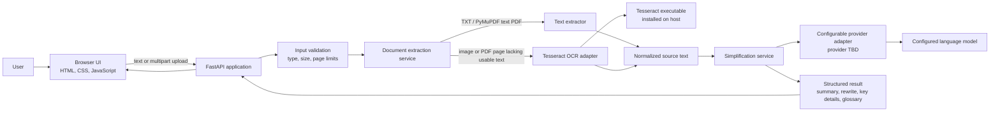

# ClearDoc: Architecture

## System overview



## Request flow

1. The browser sends pasted text or an allowlisted file to the FastAPI service.
2. The API validates the request before parsing. It enforces configured byte
   and page limits and reports unsupported or malformed input explicitly.
3. The extraction service reads text files and uses PyMuPDF to extract embedded
   PDF text first. It sends image input and only PDF pages with no usable
   extracted text to the OCR adapter, which calls the installed Tesseract
   executable through `pytesseract`.
4. Extracted text and extraction warnings are passed to the simplification
   service. The service uses a provider adapter so provider-specific code and
   credentials stay server-side.
5. The API returns a typed result with distinct fields for summary,
   plain-language explanation, key details, glossary, and warnings.
6. The browser presents the result and keeps the original available for
   comparison. MVP requests are transient; no upload or result is persisted.

## Components and boundaries

| Component | Responsibility |
|---|---|
| Browser UI | Input, upload progress/errors, consent notice, accessible result display |
| FastAPI routes | Request/response contract, HTTP status and validation errors |
| Extraction service | File-type dispatch, PyMuPDF-first PDF text extraction, page-level OCR selection |
| Tesseract adapter | Invoke installed local Tesseract through `pytesseract`, configure language/executable, surface failures |
| Simplification service | Build constrained task input, parse/validate structured output |
| Provider adapter | Server-side provider configuration and model call; no provider selected yet |

Keep routes thin and services testable without running an actual model or
Tesseract process. Use dependency injection or small adapter interfaces where
needed; avoid building a general plugin system for this MVP.

## Initial API contract

- `POST /api/simplify`
  - Accept either pasted `text` or a multipart `file`, not both.
  - Return `400` for invalid requests, `413` for configured size/page limits,
    `415` for unsupported formats, and a clear service error when OCR or the
    simplification provider is unavailable.
  - Success response shape:

```json
{
  "summary": "Short plain-language overview",
  "simplified_text": "Faithful plain-language explanation",
  "key_details": ["Important dates, amounts, obligations, or caveats"],
  "glossary": [{"term": "Example", "meaning": "Plain-language definition"}],
  "warnings": ["Verify OCR text against the original"]
}
```

The schema is a target contract, not a reason to fabricate missing information.
Validate model output and return an explicit error if it does not meet the
contract.

## Tesseract integration

Use the upstream [Tesseract OCR project](https://github.com/tesseract-ocr/tesseract)
as the OCR engine, installed separately on the host. Invoke its installed
executable through `pytesseract`; configure its executable path (for example
with `TESSERACT_CMD`) and language data explicitly. Check for the executable
and requested language data at startup or before OCR, and show a useful
configuration error if missing. The application must not silently substitute
another OCR engine.

Do not clone or compile the full upstream C++ repository as part of the
four-hour MVP implementation. Keep OCR behind an adapter so it can be tested
with a stub. Set timeouts and input limits; do not silently return empty OCR
text as a successful extraction.

## Simplification provider

The provider is configurable behind the server-side adapter; no provider has
been selected yet. Read configuration and credentials from server-side
environment settings. Keep the provider disabled with a clear
`provider not configured` error until configured, and show an explicit notice
before document text is sent to an external service. Do not expose credentials
in the browser.

## Security and privacy boundaries

- Only accept the documented extensions and verify detected content as well
  as filename; impose configurable upload/page limits.
- Use generated temporary paths if temporary files are required; clean them up
  in a `finally` path.
- Do not log source text, OCR output, prompts, model output, or credentials.
- Keep provider keys in environment configuration on the server.
- Display an explicit notice before sending content to an external provider.
- Treat document contents as untrusted data. The simplification instruction
  must not follow commands embedded in the document.
- Do not persist documents/results in the MVP.

## Verification approach

- Unit tests: file validation, PDF/text extraction dispatch, OCR adapter
  success/failure, output schema validation, and provider-unconfigured behavior.
- API tests: valid text request, unsupported/oversized file, corrupt input,
  OCR unavailable, and provider failure.
- UI smoke test: submit text, show all result sections, surface an error, and
  confirm the source remains available.
- Use fixtures/stubs for OCR and model tests; do not require external network
  access for the default test suite.
